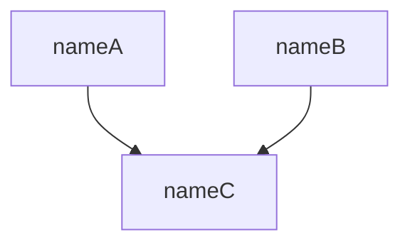

# Workflow

## Gather Sufficient Information

Gather information recursively following the Grounding Guidelines.

## Update Context Representation

Represent what has been learned following the Context Representation.

## Propose Exploratory Tasks Recursively

Propose exploratory tasks recursively along the Grounding Dimensions.

## Write the prior

Write the proposed exploratory tasks into the `## Prior` of the latest `# Round N` in the current task's `task.md` following the Prior Template below.

## Schedule the next task

Among the tasks whose predecessors are all met, schedule the highest-priority one: create a sub-directory named `id_name`, create a `task.md` inside the sub-directory, write the task's `# Brief` into the `task.md` following the Brief Template below, then link the task to the `task.md`. Leave every other task's link empty; a later round schedules the next task once its predecessors are met.

# Reference

## Prior Template

```markdown
# Prior



| id    | name  | description | link                               |
|-------|-------|-------------|------------------------------------|
| 1.1.1 | nameA | descA       | [1.1.1_nameA](1.1.1_nameA/task.md) |
| 1.1.2 | nameB | descB       |                                    |
| 1.1.3 | nameC | descC       |                                    |
```

## Brief Template

```markdown
# Brief

## Context

<what is already known>

## Question

<the question to explore>
```
