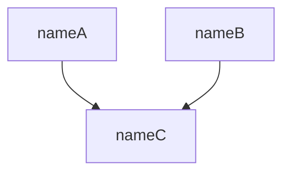

# Directory Structure

Organize progress as a recursive hierarchy of tasks:

```
~/.larify/tasks/<task>/
  task.md
  <subtask>/
    task.md
    <subsubtask>/
      task.md
```

# Task File Format

```markdown
---
name: <human-readable task title>
description: <brief description of the task>
status: <in_progress | completed>
---

# Brief

# Events

# Debrief
```

# Event Format

Append each event chronologically under `# Events`:

```markdown
## <Explore | Execute | Critique>

<event content>

### References

<references to related context>
```

# Brief Template

```markdown
---
name: <human-readable task title>
description: <brief description of the task>
---

# Brief

## What

<what to explore>

## Why

<why it matters>

## References

<references to related context>
```

# Task Graph Format

````markdown


| name  | description | link                   |
|-------|-------------|------------------------|
| nameA | descA       | [nameA](nameA/task.md) |
| nameB | descB       | -                      |
| nameC | descC       | -                      |
````
